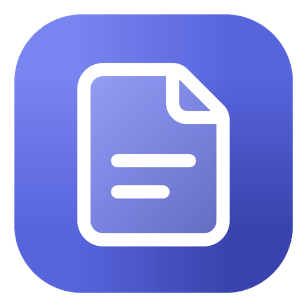
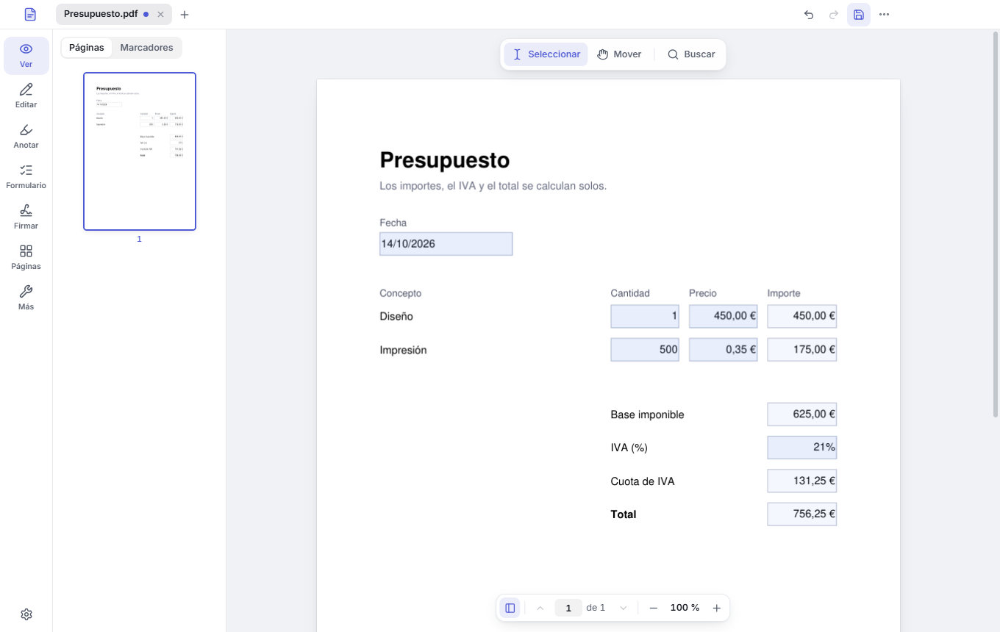
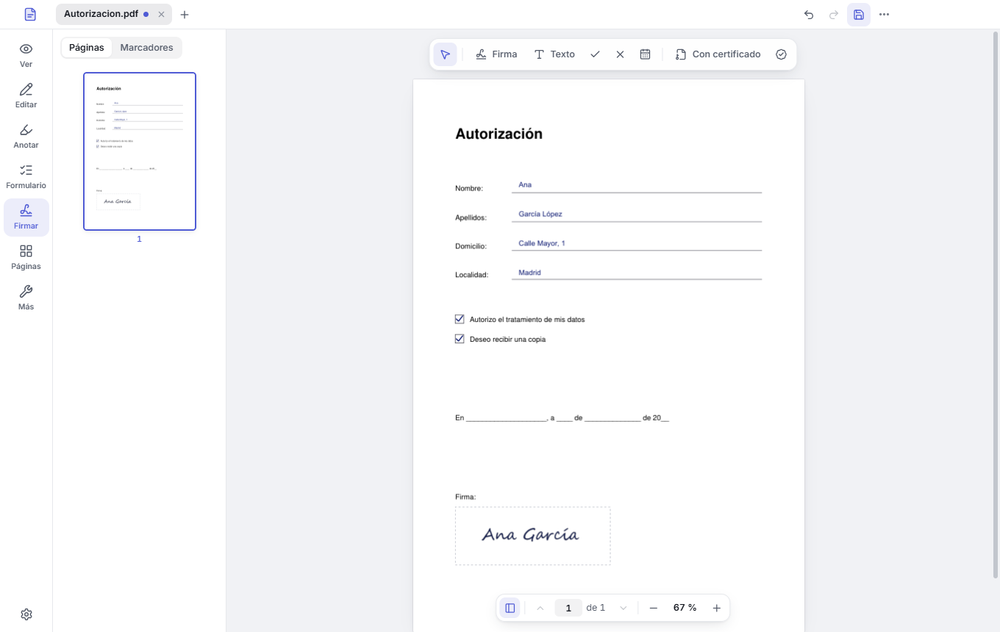
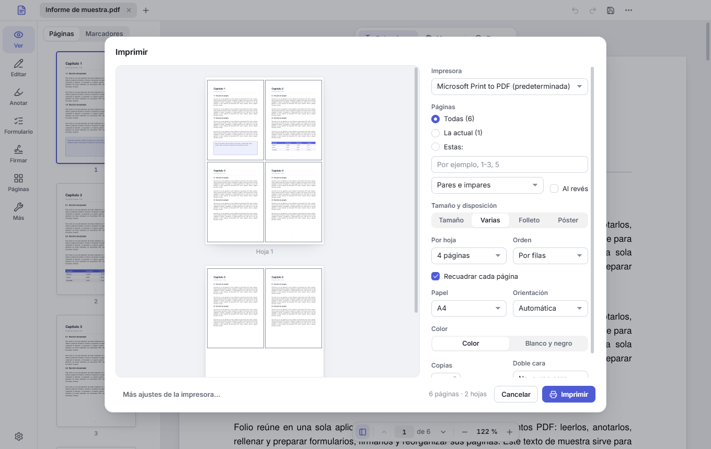

<div align="center">

[English](README.md) · **Español**



# Folio PDF

**Todo lo que necesitas hacer con un PDF, en un solo sitio.**

Lee, rellena, firma, edita y organiza tus PDF en Windows.<br>
Gratis, sin anuncios, sin cuentas y sin subir tus documentos a ningún sitio.

### [⬇&nbsp; Descargar Folio para Windows](https://github.com/CuevasTech/folio/releases/latest)



</div>

## Qué puedes hacer

- **Rellenar formularios**, también los que calculan solos los importes, el IVA y el total, y escribir en cualquier PDF aunque no tenga campos para rellenar.
- **Firmar** a mano (dibujando, escribiendo tu nombre o con una foto de tu firma) o con tu **certificado digital**, como el de la FNMT, con sello de tiempo incluido.
- **Editar** el texto del propio PDF y añadir texto, imágenes y formas.
- **Anotar**: resaltar, subrayar, tachar, notas y dibujo a mano alzada.
- **Organizar páginas**: ordenar, girar, borrar, extraer, dividir y combinar documentos.
- **Imprimir** con vista previa: varias páginas por hoja (también la misma repetida, para etiquetas u octavillas), folletos para doblar, pósteres en varias hojas, otros tamaños de papel y a doble cara.
- **Digitalizar papeles** con fotos del móvil o con tu escáner o impresora multifunción: Folio encuentra la hoja en cada foto, la endereza, quita las sombras y la deja como recién escaneada.
- **IA en tu equipo, opcional**: resume el documento, contesta preguntas indicando las páginas de donde sale cada respuesta, busca por significado, traduce y mejora textos y encuentra datos personales para censurarlos. Funciona sin Internet: los modelos solo se descargan si la activas, y tus documentos nunca salen de tu equipo.
- Y además: reconocer el texto de los escaneados (OCR), proteger con contraseña, censurar de verdad, comprimir y convertir a Word o a imágenes.

Folio está en español y en inglés, y sigue el idioma de Windows.

<p align="center">
  
  
</p>

## Tus documentos se quedan en tu equipo

Folio funciona sin conexión: no sube tus PDF a ningún servidor ni te pide una cuenta. Solo usa Internet cuando tú lo pides (el sello de tiempo de una firma, que recibe una huella del documento, nunca el documento; un comentario que nos envíes, o la descarga de los modelos de la IA, desde Hugging Face) y para avisarte de versiones nuevas. La IA también funciona en tu equipo: lo que preguntas y lo que responde no sale de él.

Además, cada PDF se abre en un espacio aislado de Windows, pensado para que un archivo con trampa no pueda tocar tus otros archivos ni conectarse a Internet.

## Instalación

1. Descarga **Folio-Setup** de la [última versión](https://github.com/CuevasTech/folio/releases/latest).
2. Ábrelo y sigue los pasos. Si Windows muestra «Windows protegió su PC», pulsa **Más información** y luego **Ejecutar de todas formas**: lo hace con los programas nuevos que aún no llevan firma digital.
3. Listo. Cuando haya una versión nueva, Folio te avisará.

Para Windows 10 y 11 de 64 bits.

## ¿Ideas o algo que no va bien?

Cuéntanoslo desde Folio, en el menú **…** → **Enviar comentarios**, o en [Issues](https://github.com/CuevasTech/folio/issues). Y si Folio te resulta útil, dale una ⭐: así lo encuentra más gente.

## Apoya Folio

Folio es gratis y lo seguirá siendo, sin anuncios ni versiones de pago. Si te resulta útil, puedes invitarme a un café en [GitHub Sponsors](https://github.com/sponsors/CuevasTech).

## Licencia

Folio es software libre con licencia [GNU AGPL, versión 3 o posterior](LICENSE), y se ofrece sin ninguna garantía. © 2026 CuevasTech.<br>
Incluye componentes de terceros con sus propias licencias: la lista está en Folio, en **Acerca de Folio → Componentes de terceros**.

<details>
<summary>Compilar desde el código</summary>

<br>

Hace falta Node 22.12 o posterior y Python 3.12 o posterior. En PowerShell:

```powershell
npm ci --ignore-scripts
npm run electron:install
py -m venv engine\.venv
engine\.venv\Scripts\python.exe -m pip install --no-deps --only-binary :all: --require-hashes -r engine\requirements.txt
engine\.venv\Scripts\python.exe -m pip install --only-binary :all: --require-hashes -r engine\requirements-build.txt
powershell -File scripts\fetch-tessdata.ps1
npm run dist
```

El instalador queda en `dist\`.

</details>
